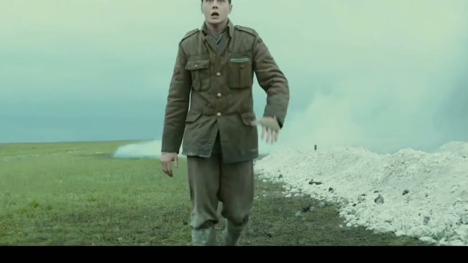

# 一条视频的解剖

在谈好不好看之前，先把一条视频拆开，看看它由哪些零件组成。这一章全是最基础的名词，但后面每一句对 AI 说的话都要用到它们。

<h2>时间：从一帧到一条片</h2>

视频是一串静止的图片快速播放。每一张图叫一帧 <small>frame</small>。一秒钟放多少张，叫帧率 <small>fps</small>。

<table>
<tr><th>帧率</th><th>看起来</th><th>常见在哪</th></tr>
<tr><td>24</td><td>略带一点“不连贯”，动得快的地方有拖影。我们从小在电影院里习惯了，于是把它认作“电影感”</td><td>电影、剧集、追求质感的广告和短片</td></tr>
<tr><td>25 / 30</td><td>比 24 顺一点，更像“现场”</td><td>电视、新闻、大多数短视频和口播</td></tr>
<tr><td>50 / 60</td><td>非常顺滑，像透过窗户看真的东西</td><td>游戏录屏、体育、界面演示；也用来拍慢动作的原始素材</td></tr>
</table>

帧率还是你说话的尺子。在 24 帧的片子里，“12 帧”就是半秒，“3 帧”是八分之一秒。动效和转场太短，用秒说不方便，行内习惯直接说帧数。你对 AI 说“闪白 4 帧”“标题提前 6 帧进”，它完全听得懂。拿不准的时候说毫秒也行，40 毫秒大约是一帧。

往上数，时间的单位是这样一层套一层的：

<table>
<tr><th>单位</th><th>是什么</th><th>大概多长</th></tr>
<tr><td>镜头 <small>shot</small></td><td>两次剪切之间连续的一段画面。剪辑的最小积木</td><td>短视频 1–4 秒，电影平均 3–8 秒，长的可以几分钟</td></tr>
<tr><td>场 <small>scene</small></td><td>同一个时间、同一个地点发生的一件事，由若干镜头组成</td><td>几十秒到几分钟</td></tr>
<tr><td>段落 <small>sequence</small></td><td>完成一个意思的一组场或一组镜头。讲解片里相当于“一个小节”</td><td>15 秒到几分钟</td></tr>
<tr><td>全片</td><td>若干段落</td><td>—</td></tr>
</table>

两个镜头之间的那个接缝叫剪切点 <small>cut</small>，口语里就说“切”或“一刀”。一条一分钟的短视频通常有 20 到 40 刀。“这里切早了”“这一刀往后挪半秒”，说的都是它。

要指出片子里的某个位置，用时间码 <small>timecode</small>：<code>00:01:23</code> 是 1 分 23 秒，后面再跟一段的话（<code>00:01:23:12</code>）是那一秒里的第 12 帧。给 AI 反馈时带上时间码，是最省事的一个习惯。

<h2>空间：画面有多大，什么形状</h2>

分辨率 <small>resolution</small>是画面的像素数。现在的底线是 1080p（1920×1080），讲究一点做 4K（3840×2160）。它只决定清不清楚，不决定好不好看。

画幅比 <small>aspect ratio</small>是宽和高的比例。这是开工前必须定下来的第一件事，因为它决定了所有构图。点一下看同一个画面被不同的框裁成什么样：

竖屏平台还有一个坑叫安全区 <small>safe area</small>。抖音、视频号这些 App 会在画面上盖一层界面：顶上是搜索栏，底下是标题和文案，右边是点赞评论一列按钮。大致来说，顶部约 12%、底部约 25%、右侧约 15% 的区域，别放必须被看到的字和脸。很多 AI 做的竖屏片子，字幕贴着底边放，发出去正好被文案盖住。

<blockquote>
<strong>别这么说</strong> 做一个竖屏的。

<strong>这么说</strong> 画幅 9:16，1080×1920，30 帧。发抖音，所以顶部 12%、底部 25%、右侧 15% 是界面遮挡区，标题、字幕和人脸都不要放进去。字幕放在画面高度 68% 左右的位置。
</blockquote>
<h2>层：时间线长什么样</h2>

所有剪辑软件的核心都是同一个东西：一条从左到右的时间线 <small>timeline</small>，上面叠着若干条轨道 <small>track</small>。画面轨道像一摞透明胶片，上面的盖住下面的；声音轨道是同时响的。AI 写代码做片子时没有这个界面，但脑子里的结构是一样的。

0s 5s 10s 15s 20s 25s 字幕 / 标题 图形 / 贴纸 箭头标注 数据图表 B-roll 补充画面 产品录屏 新闻截图 → 实拍空镜 A-roll 主画面 人对着镜头讲（口播） 人声 音效 音乐

一条口播视频的时间线。上半是画面轨道，越靠上越在前面；下半是声音轨道。竖着的那条线是播放头，它扫到哪，你就看到、听到那一刻所有轨道叠在一起的结果。

<h3>A-roll 和 B-roll</h3>

这是口播和讲解类视频里最重要的一对概念，新手几乎都不知道。

A-roll <small>A-roll</small> 是主线：通常是一个人对着镜头说话，或者一条旁白。它负责把话讲完，单独拿出来，这条视频的内容是完整的。

B-roll <small>B-roll</small> 是盖在主线上面的补充画面：讲到产品时切到产品的录屏，讲到一条新闻时贴出新闻截图，讲到“很多人”时放一段街头空镜。声音还是 A-roll 的，画面换成了别的。

为什么要有 B-roll？三个原因。第一，同一张脸看十秒以上人就开始走神，B-roll 给眼睛换东西看。第二，它是证据：你说“这个功能很快”，不如直接放一段它很快的录屏。第三，它能盖住 A-roll 上的剪切痕迹，口播里删掉一句废话，人会突然跳一下，上面盖一段 B-roll 就看不出来了。

一条“只有人在讲”的视频和一条“有人讲、画面跟着换”的视频，差别就在 B-roll。你觉得别人的口播“信息量大”“不无聊”，多半是因为每隔三五秒就有一段 B-roll。

<blockquote>
<strong>别这么说</strong> 口播太干了，丰富一下画面。

<strong>这么说</strong> A-roll 保持口播不动。每讲到一个具体的东西（产品名、数字、新闻、操作步骤），就盖一段 3 到 5 秒的 B-roll 来对应它：产品用录屏，数字用大字，新闻用原始截图。连续露脸不要超过 8 秒。讲观点和情绪的那几句不要盖，让人看到脸。
</blockquote>
<h3>素材的种类</h3>

B-roll 可以是什么？下面这张清单值得记一下，因为“画面丰富”本质上就是这些东西换着用。

<table>
<tr><th>素材</th><th>说明</th><th>AI 怎么弄到</th></tr>
<tr><td>实拍</td><td>你自己拍的人、物、环境</td><td>你提供</td></tr>
<tr><td>录屏</td><td>软件操作、网页浏览、手机界面</td><td>你提供，或它用浏览器自动录</td></tr>
<tr><td>截图与档案</td><td>新闻标题、推文、论文页、老照片、历史影像。统称“实证素材”</td><td>它去搜、去截</td></tr>
<tr><td>素材库 <small>stock</small></td><td>别人拍好的通用镜头：城市、自然、办公、手部特写</td><td>从免费或付费素材站下载</td></tr>
<tr><td>图形动效 <small>motion graphics</small></td><td>画出来并让它动的东西：图表、图标、示意图、流程</td><td>它写代码生成，这是它最拿手的</td></tr>
<tr><td>文字卡</td><td>整屏只有一句话或一个数字</td><td>它生成</td></tr>
<tr><td>AI 生成的图和视频</td><td>插画、概念图、一段几秒的生成视频</td><td>它调生图、生视频模型</td></tr>
</table>
<h2>关键帧：所有动画的原子</h2>

画面里任何东西要动，底层只有一种描述方式：关键帧 <small>keyframe</small>。意思是“在这个时刻，它是这个样子；在那个时刻，它是那个样子”。中间怎么变过去，由软件或代码自动算出来。

一个标题从屏幕下方滑上来，就是两个关键帧：第 0 帧，位置在下面 40 像素、透明度 0；第 12 帧，位置归位、透明度 100%。能打关键帧的东西叫属性 <small>property</small>，常用的就这几个：

<table>
<tr><th>属性</th><th>变化起来是什么效果</th></tr>
<tr><td>位置 <small>position</small></td><td>移动、滑入滑出</td></tr>
<tr><td>缩放 <small>scale</small></td><td>放大缩小、弹出、推近</td></tr>
<tr><td>旋转 <small>rotation</small></td><td>转动、摆动、翻转</td></tr>
<tr><td>不透明度 <small>opacity</small></td><td>淡入淡出</td></tr>
<tr><td>遮罩 / 裁切 <small>mask</small></td><td>被一条边逐渐“揭开”或“擦掉”</td></tr>
<tr><td>路径 <small>path</small></td><td>线条被画出来，形状变成另一个形状</td></tr>
<tr><td>模糊、颜色等效果参数</td><td>由虚到实、变色、发光</td></tr>
</table>

两个关键帧之间“怎么变过去”有讲究：匀速地变，还是先快后慢地变，观感差别极大。这叫缓动 <small>easing</small>，是动效好不好看的头号因素，<a href="motion.md">第 8 章</a>专门讲。

你描述任何一个动效，其实就是在口述关键帧：<strong>谁，哪个属性，从多少到多少，用多久，怎么变</strong>。记住这个句式，后面会反复用。

<h2>一条片子是怎么做完的</h2>

行业里做片子有固定的几道工序。你不需要会做，但需要知道名字，因为跟 AI 协作时最好也按这个顺序一道一道验收，而不是让它一口气做完再整体推翻。

<ol class="steps">
<li><b>脚本与分镜</b>写清楚说什么（文案），以及每一句话对应什么画面（分镜 <small>storyboard</small>）。分镜可以是画出来的草图，也可以只是一张表。</li>
<li><b>定调</b>先做一两张静态的风格帧 <small>style frame</small>：颜色、字体、版式长什么样。这一步过了再往下，不然后面全要返工。</li>
<li><b>粗剪</b>（rough cut <small>rough cut</small>）把素材按顺序排到时间线上，对上旁白，不加任何效果。只看两件事：结构顺不顺，总时长对不对。</li>
<li><b>精剪</b>（fine cut <small>fine cut</small>）逐个打磨剪切点，调整每个镜头的长短，加上转场和动效。</li>
<li><b>包装</b>加字幕、标题、图形、片头片尾。</li>
<li><b>调色与混音</b>统一全片的颜色；把人声、音乐、音效的音量摆平。</li>
<li><b>导出</b>按平台要求的规格输出文件。</li>
</ol>
<blockquote>
改得越早越便宜。分镜阶段换一个镜头是改一行字，成片阶段换一个镜头可能要重做十几秒的动效和声音。所以让 AI 先给你分镜表，你点头了再让它做。
</blockquote>
<h2>导出的那些参数</h2>

这些词你迟早会在导出界面或 AI 的回复里碰到，知道是什么就行。

<table>
<tr><th>词</th><th>意思</th><th>不知道选什么就选</th></tr>
<tr><td>封装格式 <small>container</small></td><td>文件的“盒子”，就是扩展名</td><td>MP4</td></tr>
<tr><td>编码 <small>codec</small></td><td>压缩画面的算法</td><td>H.264，所有平台都认。H.265 文件更小但兼容性差一点</td></tr>
<tr><td>码率 <small>bitrate</small></td><td>每秒用多少数据来存画面。太低会糊、会出色块</td><td>1080p 给 8–12 Mbps，4K 给 35–45 Mbps</td></tr>
<tr><td>音频</td><td>—</td><td>AAC，48 kHz，立体声，192 kbps 以上</td></tr>
<tr><td>响度 <small>loudness</small></td><td>整条片听起来有多响。单位 LUFS，数字越接近 0 越响</td><td>网络平台大多按 −14 LUFS 左右归一，照这个做</td></tr>
</table>
<blockquote>
<strong>别这么说</strong> 导出一下。

<strong>这么说</strong> 导出 MP4，H.264，1080×1920，30 帧，码率 10 Mbps 左右；音频 AAC 48 kHz，整体响度归一到 −14 LUFS，峰值不超过 −1 dB。导出后自己抽帧检查一遍：有没有黑帧、字幕有没有出安全区、结尾有没有被截断。
</blockquote>
<h2>开工前要交代的硬信息</h2>

把这一章的东西攒起来，就是每次开工前该告诉 AI 的那几行。它们不涉及任何审美，但少一项就可能整条重做。

<strong>开工硬参数</strong>
<pre><code>平台与画幅：抖音 / 9:16 / 1080×1920 / 30fps
目标时长：60 秒以内（可以短，不要超）
安全区：顶部 12%、底部 25%、右侧 15% 不放关键内容
素材：/素材 文件夹里有 1 段口播原片、6 张产品截图、2 段录屏
缺的素材：可以自己画图形动效；需要实拍空镜就去免费素材站找，找不到告诉我
声音：口播原声保留；配一首不抢戏的音乐；关键动作配音效
字幕：全程要，逐句出，中文，一行不超过 14 个字
交付：先给分镜表让我确认，再做粗剪，最后出成片 MP4</code></pre>

<a href="index.md">上一章 · 这份手册怎么用</a> · <a href="frame.md">下一章 · 景别、角度与构图</a>

