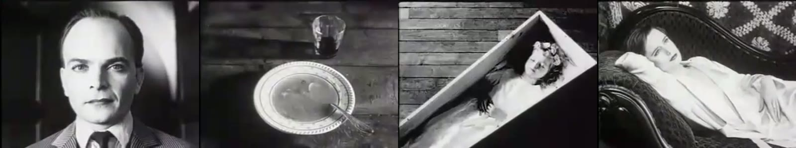
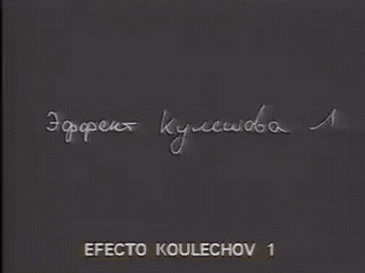
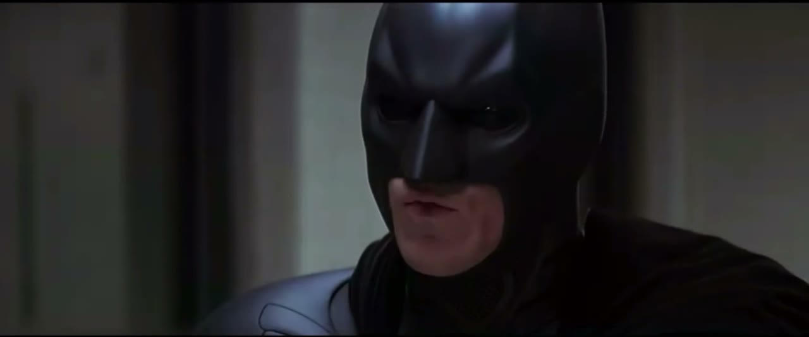
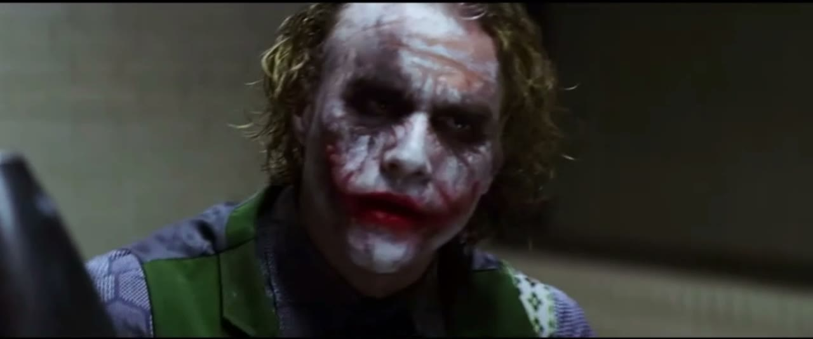
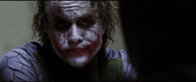
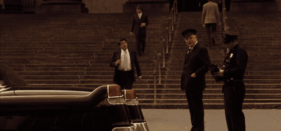
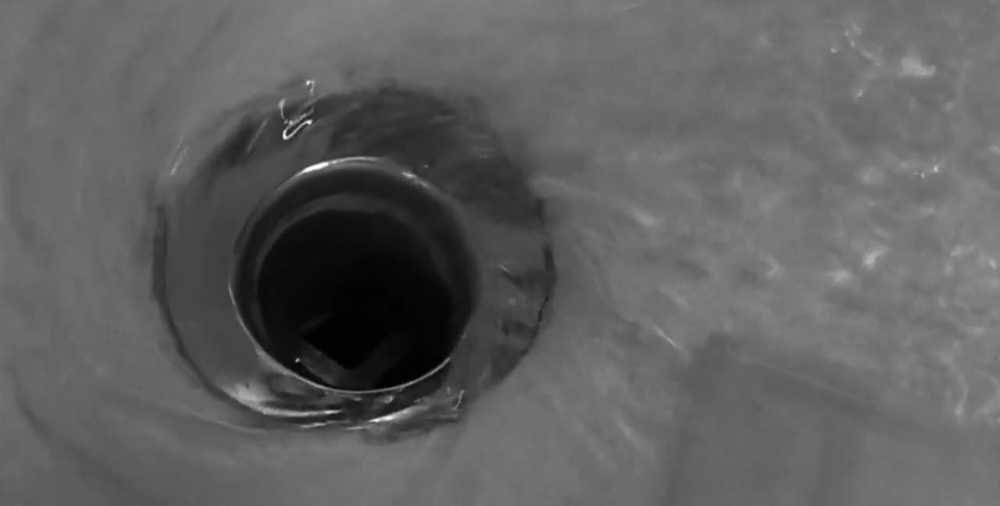
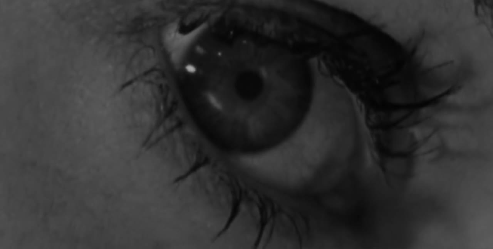
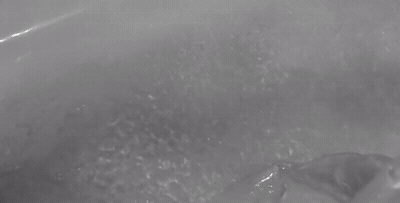
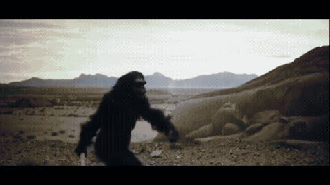

# 切点与连贯

剪辑是把两个镜头接在一起。接在哪一帧、接上什么，决定了观众看到的是一个连贯的世界，还是一堆碎片。这一章讲最核心的那一刀。

<h2>两个镜头接在一起，会长出第三个意思</h2>

一百年前，苏联导演列夫·库里肖夫做过一个实验。他拿一个演员面无表情的特写，分别接在三个画面后面：一碗汤、棺材里的孩子、躺椅上的女人。观众看完后称赞这个演员演技精湛：看汤的时候很饿，看孩子的时候很悲伤，看女人的时候有欲望。而那张脸，从头到尾是同一个镜头。

同一张脸，接在汤、棺材、女人之后，被读成了饥饿、悲伤、欲望。这是后人重拍的实验演示。 <small>库里肖夫效应演示片段</small>

动起来看更明显。注意你自己的反应：明知道是同一个镜头，还是会忍不住给那张脸“配”上情绪。 <small>库里肖夫效应演示片段</small>

这就是库里肖夫效应 <small>Kuleshov effect</small>，也是全部剪辑的地基：<strong>单个镜头的意思是不确定的，观众会根据它前后接的东西，自己把意思补出来。</strong>A 镜头加 B 镜头，得到的不是 A+B，而是一个新的 C。

这对你有两个直接的用处。第一，一个平淡的素材可以靠前后文“救”活：一张普通的人脸接在一条惊人的数据后面，就成了“震惊”。第二，接错了会产生你不想要的意思：一个人讲完话，你接了一个别人皱眉的镜头，观众就认为那个人不同意他。

<h2>剪辑在做三件事</h2>
<table>
<tr><th>做什么</th><th>说明</th><th>例子</th></tr>
<tr><td>删</td><td>把不需要的时间拿掉。现实中十分钟的事，片子里十秒讲完</td><td>一个人出门到公司：关门，上车，推开办公室的门。三个镜头，三秒</td></tr>
<tr><td>接</td><td>决定谁挨着谁，由此产生意思</td><td>库里肖夫实验；讲完一个观点接一张证据截图</td></tr>
<tr><td>控</td><td>决定每个镜头留多久，由此产生节奏</td><td>越剪越快是紧张；突然给一个长镜头是喘息</td></tr>
</table>

这一章讲“删”和“接”，下一章讲“控”。

<h2>为什么在这里切：六个理由</h2>

剪辑师沃尔特·默奇（《现代启示录》《教父》的剪辑师）在《眨眼之间》这本书里，给“一个好的剪切点”列了六条标准，并且给了权重。这张表在行内被引用了三十年，值得原样看一遍。

<table>
<tr><th>标准</th><th>权重</th><th>问的是</th></tr>
<tr><td>情绪</td><td>51%</td><td>这一刀让观众此刻的感受对不对</td></tr>
<tr><td>故事</td><td>23%</td><td>这一刀有没有把事情往前推</td></tr>
<tr><td>节奏</td><td>10%</td><td>这一刀落在的时间点舒不舒服</td></tr>
<tr><td>视线</td><td>7%</td><td>切过去之后，观众的眼睛是不是正好落在新画面的重点上</td></tr>
<tr><td>画面平面</td><td>5%</td><td>左右关系、轴线有没有乱</td></tr>
<tr><td>三维空间</td><td>4%</td><td>人物在空间里的位置关系是否连贯</td></tr>
</table>

重点是那个排序。默奇说，如果必须牺牲，就从下往上放弃：宁可空间上有点不连贯，也要保住情绪。新手恰恰相反，花大力气保证动作接得严丝合缝，却没问这一刀切下去感觉对不对。

“视线”这一条对快节奏的片子尤其实用。上一个镜头结束时观众的眼睛在画面哪个位置，下一个镜头的重点就该出现在哪个位置附近。眼睛不用找，剪得再快也跟得上。这正是<a href="taste.md">《疯狂的麦克斯》</a>全片把主体放在中心的原因。

<h2>连贯剪辑：让观众忘记有剪辑</h2>

好莱坞在一百年里磨出了一套规则，目的只有一个：让观众感觉不到剪切，只觉得自己在看一件连续发生的事。这套规则叫连贯剪辑 <small>continuity editing</small>。你不需要全背下来，但要认得其中几个名字，因为它们同样是 AI 剪口播、剪对话、剪教程时的默认语法。

<h3>正反打和轴线</h3>

两个人对话，最标准的拍法是：一个镜头拍 A（常常带着 B 的肩膀），一个镜头拍 B，来回切。这叫正反打 <small>shot / reverse shot</small>。

镜头一：他在画面右侧，面朝左。

镜头二：他在画面左侧，面朝右。两人的视线在画面外“对上”了。

《黑暗骑士》审讯戏的一段。注意每一刀切在哪里：多数时候不是等一个人把话说完才切，而是在话说到一半时就切去看对方的反应。 <small>《蝙蝠侠：黑暗骑士》(2008)，导演 克里斯托弗·诺兰，剪辑 李·史密斯</small>

正反打之所以不乱，是因为遵守了180 度轴线 <small>180-degree rule</small>：在两个人之间画一条假想的线，所有机位都待在这条线的同一侧。这样 A 永远在画面左边朝右看，B 永远在右边朝左看。一旦摄影机越过这条线，两个人在画面上会突然换边，观众会懵一下：他们换位置了？

轴线 A B 机位 1 机位 2 机位 3 机位都在这一侧：安全 越过轴线：两人在画面上互换左右 机位 1：A 在左，朝右 机位 3：B 在右，朝左 越轴：B 跑到了左边

轴线的道理不限于对话。一个人朝右走，下一个镜头他还得朝右；一辆车从左开到右，切了镜头不能变成从右到左，否则观众以为它掉头了。

对用 AI 的人来说，轴线最常见的用处是<strong>方向的一致</strong>：流程图从左往右，那全片的“前进”就都是往右；一个东西从左边滑出去，下一个画面它应该从左边滑进来还是从右边？答案是右边进来往左走才接得上运动方向，除非你要表达“回来了”。

<h3>在动作中间切</h3>

动作切 <small>cut on action</small>是最常用的隐藏剪切的办法：在一个动作进行到一半的时候切到另一个角度，让动作在下一个镜头里完成。比如一个人伸手去开门，手刚碰到门把时切到门的另一侧，门被推开。观众的注意力被动作牵着走，根本察觉不到镜头换了。

反过来，等一个动作完全做完、人静止下来再切，这一刀就会很显眼，节奏也会一顿一顿的。所以有一句老话：切在动的时候，不要切在停的时候。对图形动效也一样：趁元素还在运动的时候切走或者让下一个元素进来，比等它彻底停稳再接下一步要流畅。

<h3>视线匹配</h3>

视线匹配 <small>eyeline match</small>：先给一个人往画面外某处看的镜头，再切到他看的那个东西。库里肖夫实验用的就是它。它是把“人”和“信息”连起来最自然的方式：口播里的人往下瞥了一眼，切到手机屏幕；主持人看向旁边，切到嘉宾。

<h3>跳切</h3>

如果相邻两个镜头的景别和角度几乎一样，只是时间上跳了一段，画面里的人会突然“抖”一下。这叫跳切 <small>jump cut</small>。连贯剪辑的规矩是尽量避免它，办法叫<strong>30 度规则</strong>：相邻两个镜头，机位角度至少差 30 度，或者景别明显不同。

但是跳切后来成了一种风格。戈达尔在 1960 年的《精疲力尽》里故意用它来打破流畅感；六十年后，它成了所有口播视频的标配：把一段话里的停顿、口误、废话全剪掉，人就在同一个景别里一跳一跳地说下去。观众早已习惯，甚至会觉得这样更“干货”、更快。

口播的跳切有三种常见的处理方式，可以直接点给 AI：

<table>
<tr><th>处理</th><th>做法</th><th>效果</th></tr>
<tr><td>保留跳切</td><td>直接硬接，不掩饰</td><td>快、直接、有网感。Vlog 和知识类口播的默认</td></tr>
<tr><td>缩放遮掩 <small>punch in</small></td><td>每隔一句把画面放大到 110%–120%，下一句再回到 100%，像是换了个景别</td><td>看起来像两个机位，跳的感觉被“合理化”了，还顺便做了强调</td></tr>
<tr><td>B-roll 遮掩</td><td>在剪切点上面盖一段别的画面，声音连续</td><td>完全看不出剪过。最干净，但需要有 B-roll 可盖</td></tr>
</table>
<blockquote>
<strong>别这么说</strong> 把口播剪紧凑一点。

<strong>这么说</strong> 把口播里超过 0.35 秒的停顿、所有的“嗯”“那个”“就是说”和重复说的句子都剪掉，剪切点留 2 到 3 帧的气口，不要咬字。剪切点的处理：每隔一句话在 100% 和 115% 两个画面大小之间切换；凡是讲到具体东西的地方用 B-roll 盖住。最重要的那一句前后各留半秒停顿，不要剪掉。
</blockquote>
<h3>插入和切出</h3>

两个随手就能用的小镜头：

<ul>
<li>插入镜头 <small>insert</small>：切到场景内的一个细节特写。手在键盘上、屏幕上的一行字、桌上的咖啡。</li>
<li>切出镜头 <small>cutaway</small>：切到场景外的一个相关画面。讲到“去年”时切一张去年的照片；讲到用户时切一段用户的评论截图。B-roll 大部分都是切出镜头。</li>
</ul>

还有一个值得单独记的：反应镜头 <small>reaction shot</small>。事情发生后，切到一个人看到它时的表情。喜剧的笑点、惊悚的吓点、综艺的梗，一多半落在反应镜头上而不是事件本身。口播里说完一个离谱的事实之后，切回讲述者自己无语的脸停半秒，就是一个反应镜头。

<h2>把两条线剪在一起</h2>
<h3>交叉剪辑</h3>

交叉剪辑 <small>cross-cutting</small>是在两个（或更多）不同地点同时发生的事情之间来回切。它让观众觉得这些事有关联：要么即将相撞（警察在赶来，凶手在动手），要么互为对照。

影史最著名的交叉剪辑。教堂里，迈克尔作为教父在洗礼上回答“你是否弃绝撒旦”；教堂外，他派出的人正在逐一清除对手。两条线越切越快，神父的问答和管风琴声一直铺在所有画面下面，把仪式和杀戮焊在了一起。 <small>《教父》(1972)，导演 弗朗西斯·科波拉，剪辑 威廉·雷诺兹、彼得·津纳</small>

这一段还示范了一件事：<strong>声音可以把分开的画面粘起来</strong>。画面在两地之间跳，但声音始终是教堂里的那一条，观众就把它们读成了“同一件事的两面”。讲解片里用同一条旁白串起不同来源的素材，是完全一样的原理。

<h3>匹配剪辑</h3>

匹配剪辑 <small>match cut</small>是让前后两个镜头在某一方面“对上”：形状、位置、运动方向、颜色或者声音。两个本来不相干的画面因此被强行联系起来，而且过渡得非常顺。

浴缸的排水口，水打着旋流进去。

慢慢化成了一只一动不动的眼睛。圆对圆，旋转对旋转。

《惊魂记》浴室戏的收尾。希区柯克用一个形状上的匹配，从“血流走了”过渡到“她死了”，没有一句台词。 <small>《惊魂记》(1960)，导演 阿尔弗雷德·希区柯克，剪辑 乔治·托马西尼</small>

匹配剪辑里名气最大的一个，在库布里克的《2001 太空漫游》里。猿人把骨头抛向天空，骨头在空中翻转，下一个镜头直接接上一艘形状相似的飞船。一刀跨过了几百万年。

骨头是人类的第一件工具，飞船是最新的一件。库布里克没有用任何字幕解释，只让两个形状对上。 <small>《2001 太空漫游》(1968)，导演 斯坦利·库布里克</small>

<table>
<tr><th>匹配什么</th><th>怎么做</th><th>在讲解片里的用法</th></tr>
<tr><td>形状 <small>graphic match</small></td><td>两个画面里有形状、位置相近的东西</td><td>一个圆形的 logo 接一个圆形的饼图；一张照片的边框接下一张照片的边框</td></tr>
<tr><td>动作 <small>match on action</small></td><td>前一镜的动作在后一镜继续</td><td>手指向右划，下一个画面从右边滑入</td></tr>
<tr><td>位置 <small>eye trace</small></td><td>前后两镜的重点在画面同一位置</td><td>上一屏的数字在中间，下一屏的标题也在中间</td></tr>
<tr><td>声音 <small>sound match</small></td><td>一个声音接到另一个相似的声音</td><td>键盘的“嗒”接到钟表的“嗒”</td></tr>
</table>

匹配剪辑是所谓“高级转场”的真正来源。它不靠任何特效，靠的是提前设计好前后两个画面的构图。要求 AI 做匹配剪辑时，你得同时指定两个镜头。

<blockquote>
<strong>这么说</strong> 第 4 镜结尾是那张圆形的 logo 居中。第 5 镜开头的饼图也放在正中，大小和 logo 完全一样。两镜之间硬切，让圆直接“变成”饼图，然后饼图再展开成各个扇区。
</blockquote>
<h3>急切</h3>

急切 <small>smash cut</small>是从一个状态毫无预兆地硬切到完全相反的状态：从尖叫切到寂静，从“我绝对不会去”切到他已经站在现场。它利用的是反差，常用于喜剧和惊吓。声音在这里比画面更关键：前一个镜头的声音必须在剪切点上戛然而止。

<h2>切早一点，还是晚一点</h2>

同一个剪切点，前后挪几帧，感觉会变。一些经验：

<ul>
<li><strong>晚进早出。</strong>一个镜头，在“事情已经开始了”的时候切进来，在“事情刚做完、还没凉”的时候切走。新手总是从头放到尾，前后都拖着一截没用的时间。</li>
<li><strong>话没说完就切。</strong>对话里，在说话的人说到最后几个字时就切到听的人，会比等他说完再切流畅得多。</li>
<li><strong>切在眨眼上。</strong>默奇的观察：人在想完一件事的时候会眨眼。在人物眨眼的那一下切，往往正好是一个想法结束的地方。</li>
<li><strong>留一拍。</strong>一句有分量的话说完，别马上切。多留十几帧，让它落地。这多出来的半秒就是“呼吸感”。</li>
<li><strong>开头的黑场和结尾的尾巴都剪掉。</strong>素材两头经常有准备动作和收尾动作：看镜头、伸手关机、笑场。</li>
</ul>
<blockquote>
<strong>别这么说</strong> 这里接得不顺，再剪一下。

<strong>这么说</strong> 第 6 镜切到第 7 镜的地方：现在是等他把手完全放下才切的，太晚了。把剪切点提前到他手开始往下落的那一帧。第 7 镜的开头再去掉 8 帧，直接从他开口的地方进。
</blockquote>
<h2>默认用硬切</h2>

这一章讲的所有接法：正反打、动作切、匹配剪辑、交叉剪辑，镜头之间都是直接接上的，没有任何过渡效果。这叫硬切 <small>hard cut</small>。它是剪辑的默认状态，电影里九成以上的剪切点都是它。

淡入淡出、叠化、划像这些<a href="rhythm.md">转场</a>，是在硬切之外有特别用意时才用的。如果你发现自己总想在两个镜头之间加点什么“让它顺一点”，通常说明这两个镜头本身接得不对：景别没跳开，方向没接上，或者切点的位置不对。先解决那个问题。

<blockquote>
<strong>这么说</strong> 剪辑规则：镜头之间一律硬切。相邻两个镜头的景别至少差一级。屏幕上运动的方向保持一致，“往前”始终是向右。切点落在动作进行中，不要等动作停下。每个镜头晚进早出，不留头尾的空白。
</blockquote>

<a href="camera.md">上一章 · 运镜</a> · <a href="rhythm.md">下一章 · 蒙太奇、节奏与转场</a>

