# 向导演和频道学

一个导演的“风格”，拆开看就是几条他从不违反的规则。把规则认出来，你就能借走它，也能用它来给 AI 指路。

<h2>风格是一组规则</h2>

你说得出“这像韦斯·安德森”“这很王家卫”，说明这些导演的片子有可以被识别的特征。这些特征不神秘，它们是导演在六组旋钮上做的固定选择：他总用什么构图，镜头怎么动，怎么剪，什么颜色，什么声音。

这一章挑了十几个辨识度最高的导演和几个内容频道，把每一位压缩成三四条规则。目的有两个。一是练眼睛：看过这些拆解，你再看片子会自动开始找规则。二是给你一批现成的参照：对 AI 说“像韦斯·安德森”不如说出那四条规则管用，但两样一起说最管用。

<h2>构图和调度</h2>
<h3>韦斯·安德森：对称，正面，平移</h3>

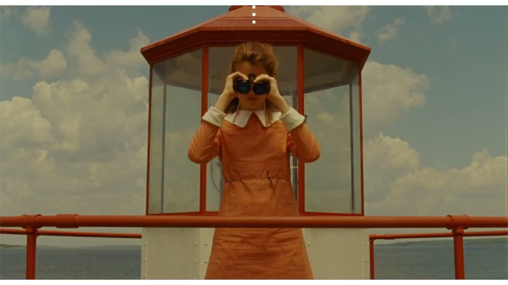

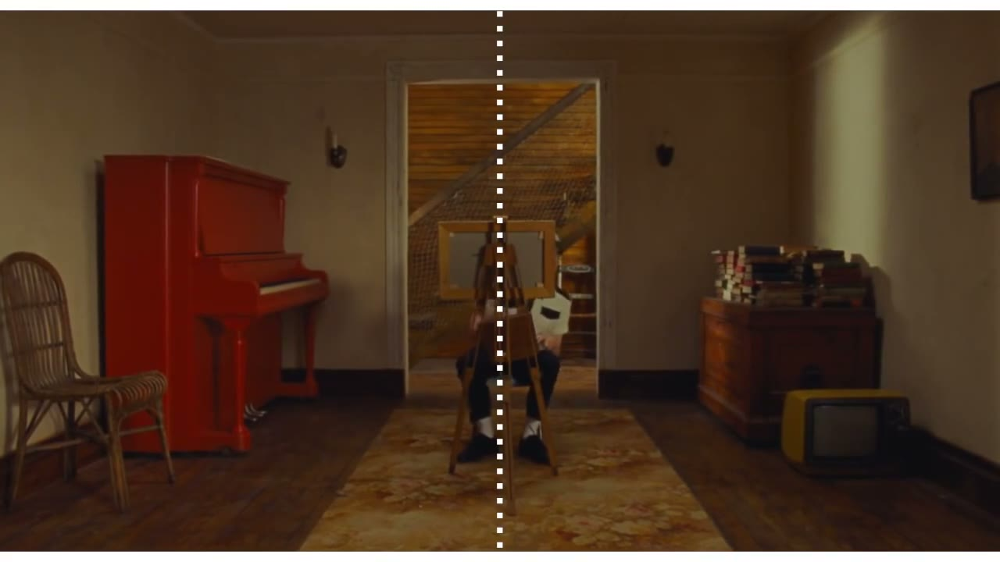

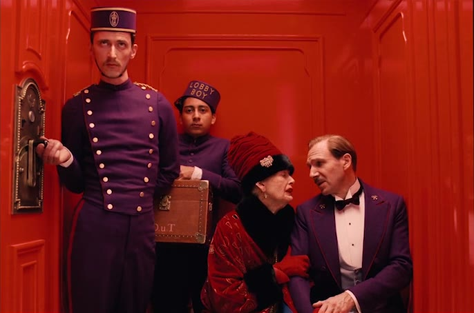

<ul>
<li>主体压在画面正中，左右严格对称。</li>
<li>摄影机永远正对着墙，或者与墙成 90 度。几乎没有斜角度。</li>
<li>镜头只做三种运动：横移、推拉、九十度的快速摇。全是直线。</li>
<li>每部片一套糖果色的色板，从布景到服装全部服从。</li>
<li>字幕和章节标题用居中的无衬线体，像图书的扉页。</li>
</ul>

<strong>可以借什么：</strong>对称和正面带来的“被精心安排过”的感觉。做产品展示、清单类内容、章节页时很好用。

<blockquote>
<strong>这么说</strong> 构图规则参考韦斯·安德森：所有画面严格左右对称，主体居中，机位正对，不要任何斜角度。镜头只做水平横移和正向推拉，运动是匀速的直线。配色限定在粉、淡黄、薄荷绿和一个深红。章节标题居中，全大写，字距加宽。
</blockquote>
<h3>小津安二郎：低机位，不动，空镜</h3>

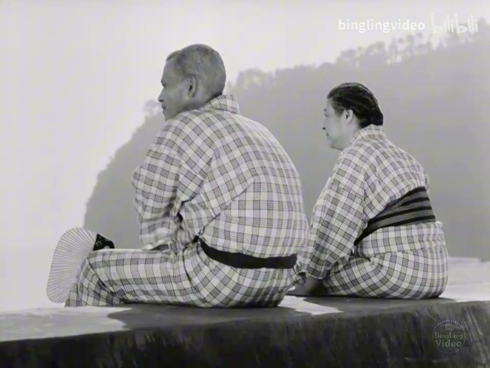

摄影机放在坐着的人的视线高度，一动不动。

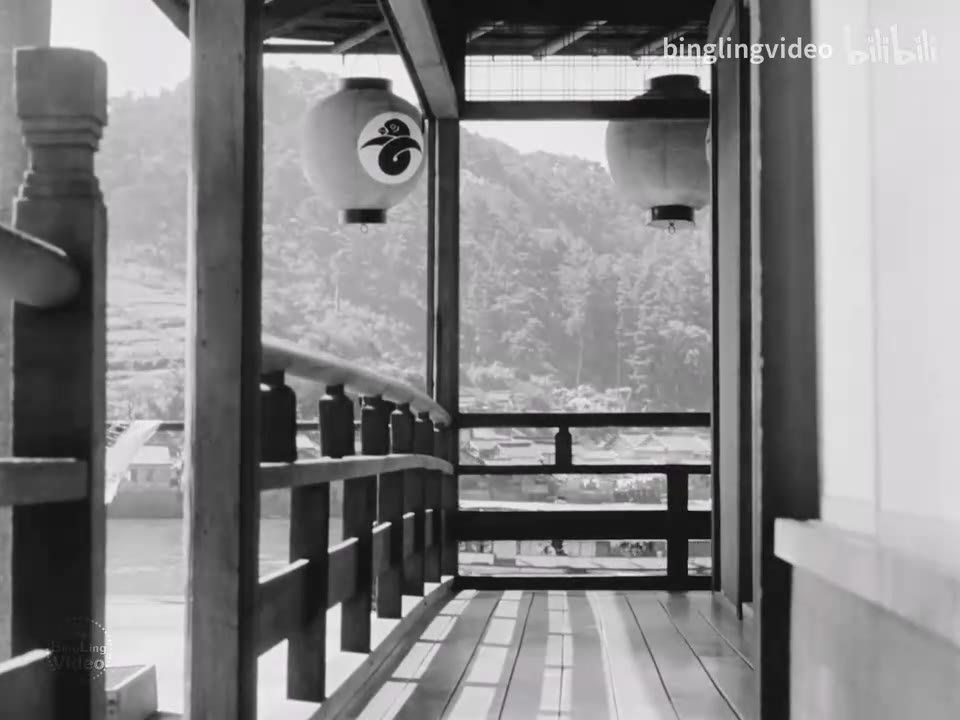

场景之间插入的空镜：走廊、晾衣杆、烟囱。没有人，只是让时间过去。

《东京物语》(1953)，导演 小津安二郎

<ul>
<li>摄影机放得很低，大约是人跪坐在榻榻米上的高度，略微仰视。</li>
<li>几乎从不移动摄影机，也不用淡入淡出，只有硬切。</li>
<li>对话时让人物几乎直视镜头说话。</li>
<li>场与场之间不用转场，而是插入几个安静的空镜。影评人叫它“枕镜头”，像诗里的停顿。</li>
</ul>

<strong>可以借什么：</strong>空镜作为换气。一段密集的信息之后，放两秒不讲任何事的安静画面，比任何转场都高级。

<h3>黑泽明：画面里永远有东西在动</h3>

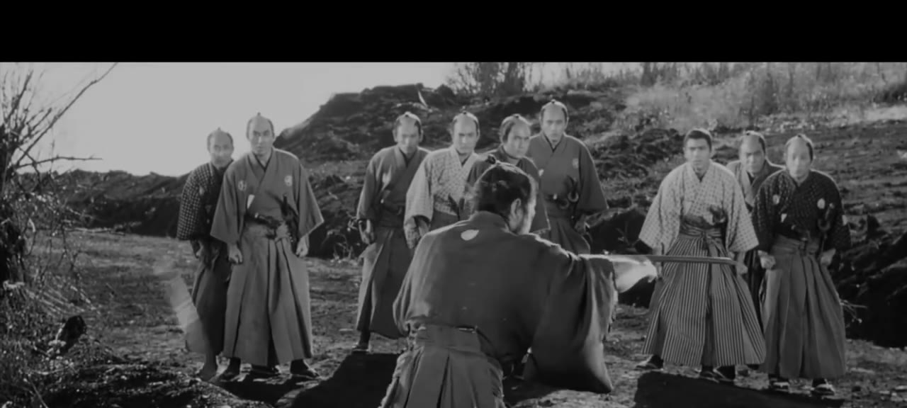

一群人，每个人的姿态和朝向都不同，前后站成几层。黑泽明的群像从来不是站成一排的。 <small>黑泽明作品，截自视频论文《Akira Kurosawa: Composing Movement》(Every Frame a Painting)</small>

<ul>
<li>画面里总有运动：风、雨、烟、火、旗子、奔跑的人群。天气是他的演员。</li>
<li>人物的情绪用身体的大动作表现，而不是靠台词。</li>
<li>群像按几何形状安排，前中后景都有人，每个人做不同的事。</li>
<li>镜头的运动有明确的起点、过程、终点，一个镜头讲完一件小事。</li>
<li>转场爱用划像。《星球大战》的划像就是从他这里学的。</li>
</ul>

<strong>可以借什么：</strong>“背景里有东西在动”。静态的画面加一层飘动的元素（雪、尘、光斑、缓慢流动的背景），立刻就有了生气。

<h3>斯坦利·库布里克：单点透视</h3>

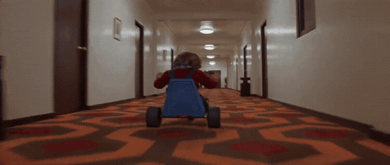

《闪灵》里跟着三轮车穿过酒店走廊的镜头。摄影机贴着地面，稳稳地跟在孩子身后，走廊的线条全部汇向正前方。车轮从地毯滚上木地板再滚回地毯，声音一响一闷，不安就是这么攒起来的。 <small>《闪灵》(1980)，导演 斯坦利·库布里克，斯坦尼康操作 加勒特·布朗</small>

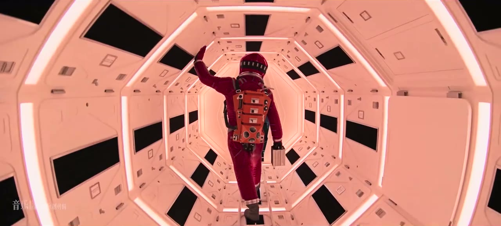

《2001 太空漫游》：八边形的通道，人在正中。

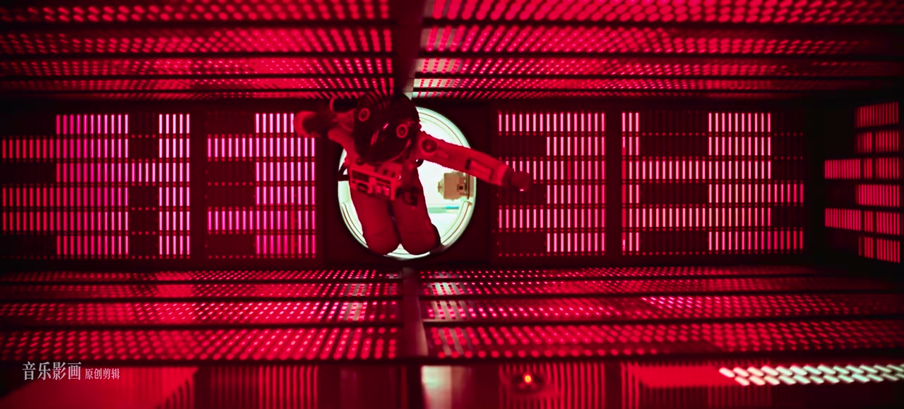

同一部片：只剩红色，仍然是中心对称。

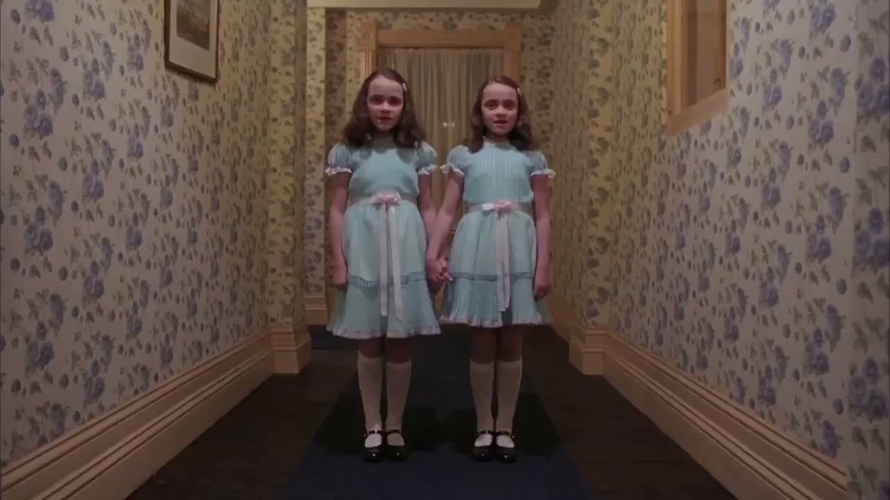

《闪灵》：走廊尽头的双胞胎。对称在这里是吓人的。

《2001 太空漫游》(1968)、《闪灵》(1980)，导演 斯坦利·库布里克

<ul>
<li>走廊、房间、道路，所有的线条都汇聚到画面正中的一个点。主体就站在那个点上。</li>
<li>对称，但和安德森的可爱不同，他的对称是冰冷、压迫的。</li>
<li>缓慢而稳定的推拉和跟拍。《闪灵》里跟着三轮车穿过酒店走廊的镜头，是斯坦尼康最早的经典用法之一。</li>
<li>人物抬起眼睛、低着头直视镜头，后来被叫作“库布里克凝视”。</li>
</ul>

<strong>可以借什么：</strong>单点透视加慢推，是制造“庄严”或“不安”最省事的组合。

<h2>剪辑和节奏</h2>
<h3>爱森斯坦和希区柯克</h3>

这两位前面已经专门讲过。<a href="rhythm.md">爱森斯坦</a>教的是：把冲突的镜头撞在一起，把一个瞬间用几十个镜头拉长。<a href="cut.md">希区柯克</a>教的是：让观众比角色先知道危险（桌下有炸弹，角色还在聊天），悬念就来自这个信息差；以及用纯粹的画面讲故事，他自称能把任何一场戏拍成默片观众也看得懂。

<h3>埃德加·赖特：把琐事剪成动作片</h3>

他的片段在<a href="rhythm.md">节奏一章</a>出现过。规则：

<ul>
<li>日常动作（倒茶、开门、穿衣）拆成一连串不到半秒的大特写，每个配一声夸张的音效。</li>
<li>用急推和甩镜做强调和转场，一切都卡在音乐上。</li>
<li>笑点藏在画面里：人物从画框外突然出现，背景里发生的事，镜头一摇露出的东西。</li>
<li>场景之间用匹配剪辑和遮挡转场连接，很少有一刀“普通的”切换。</li>
</ul>

<strong>可以借什么：</strong>“快切特写加音效”这一招，用在教程的准备步骤、Vlog 的出门流程、产品的开箱上，几秒钟讲完一个过程，还很好看。

<blockquote>
<strong>这么说</strong> 把“准备工作”这一段做成埃德加·赖特式的快切：6 个大特写，每个 8 到 10 帧，每个只拍一个动作的完成瞬间（按下开关、盖上盖子、拉上拉链）。每一刀配一个放大了的写实音效，全部卡在鼓点上。第 3 个和第 6 个镜头加一个急推。
</blockquote>
<h3>克里斯托弗·诺兰：多条时间线交叉</h3>

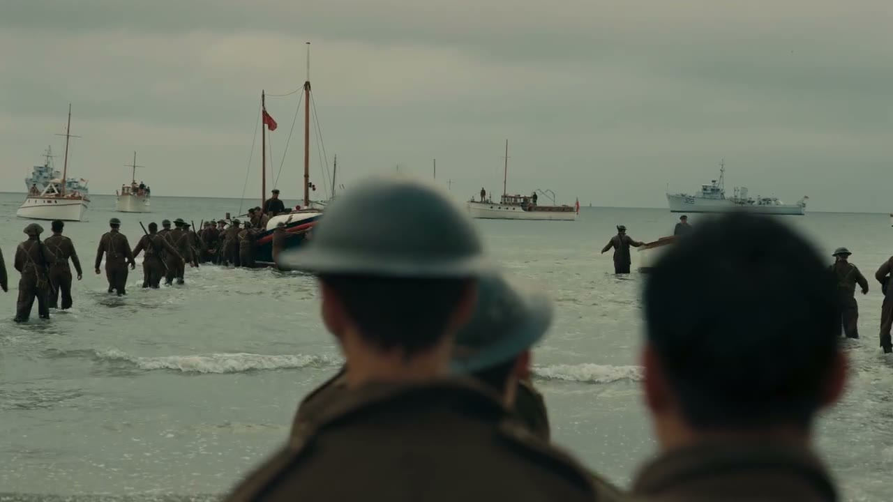

陆地：海滩上等船的士兵，这条线跨一个星期。

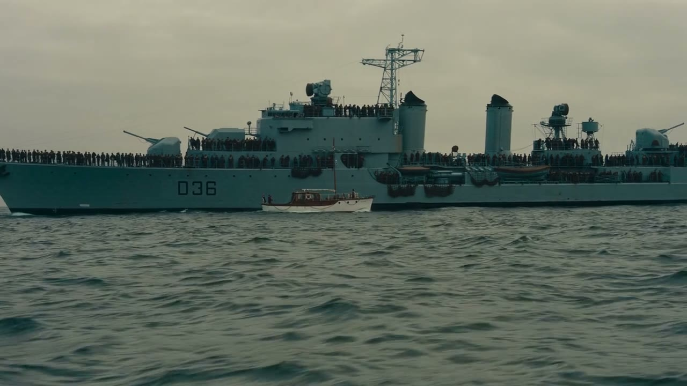

海上：来接人的船，这条线跨一天。

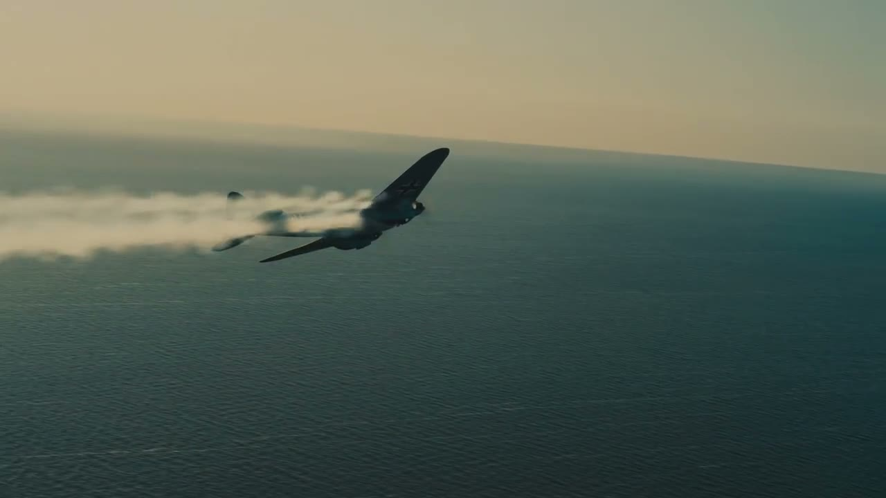

空中：护航的战斗机，这条线只有一小时。

《敦刻尔克》(2017)，导演 克里斯托弗·诺兰，摄影 霍伊特·范·霍特玛。三条长度不同的时间线被交叉剪在一起，在结尾的同一刻汇合。

<ul>
<li>把两三条不同时间、不同地点的线索交叉剪在一起，越到后面切得越快，最后汇合。《盗梦空间》的多层梦境、《敦刻尔克》的陆海空三条线都是这个结构。</li>
<li>配乐持续地往上爬，中间几乎不停，把交叉的线索捆成一股。</li>
<li>偏爱实拍和大画幅，画面厚重。</li>
</ul>

<strong>可以借什么：</strong>讲两件有关联的事时，不要讲完一件再讲另一件，交叉着讲，最后让它们在同一个结论上相遇。

<h3>达米恩·查泽雷：剪辑跟着音乐走</h3>

《爆裂鼓手》和《爱乐之城》都出自他。规则很单纯：音乐是骨架，画面的每一刀、每一次甩镜、每一个推近，都对着音乐里的某个事件。他的片段是学“声画同步”最好的教材，前面<a href="camera.md">运镜</a>和<a href="rhythm.md">节奏</a>两章各用了一段。

<h3>乔治·米勒：中心构图加极速剪辑</h3>

<a href="taste.md">《疯狂的麦克斯：狂暴之路》</a>的方法：每个镜头的视觉重点都放在画面正中，这样镜头可以切得极快而观众不会跟丢。它证明了“快”和“清楚”可以兼得，前提是你管住了观众的眼睛。

<h2>光和颜色</h2>
<h3>王家卫：抽帧，霓虹，前景遮挡</h3>

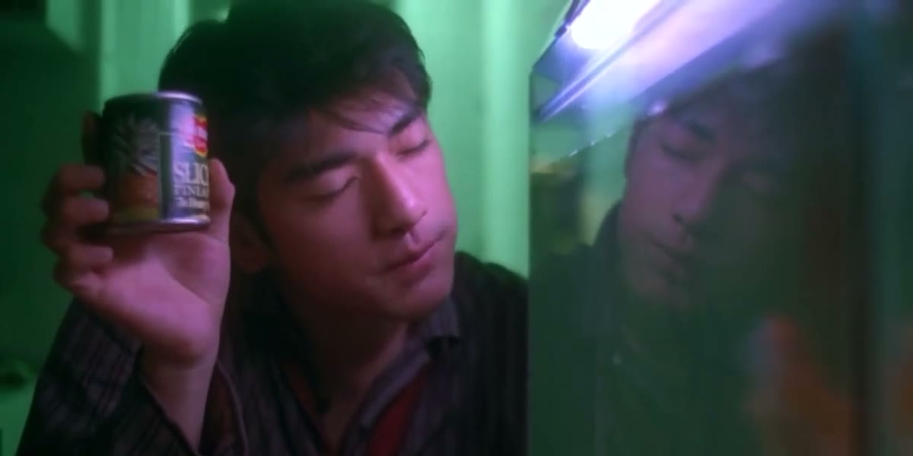

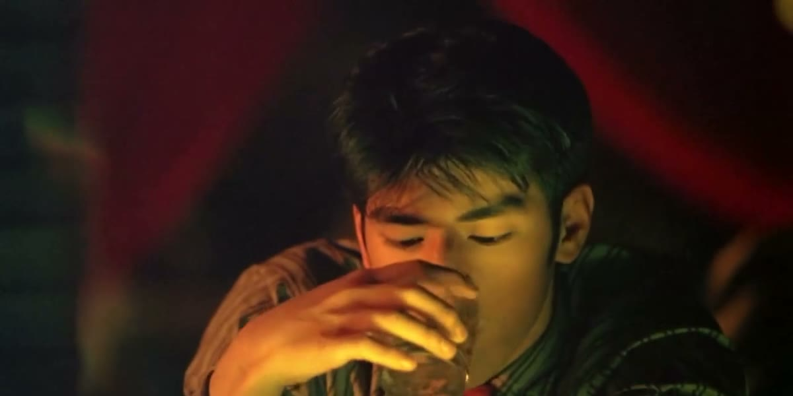

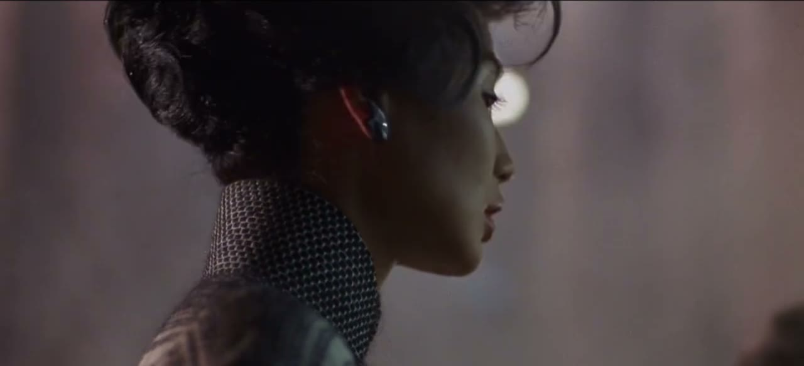

《重庆森林》(1994)、《花样年华》(2000)，导演 王家卫

<ul>
<li>抽帧：用很慢的快门拍，再把帧重复印几次。运动的东西拖出残影，人物却像定在那里。那种“周围都在飞逝，只有我是静止的”的孤独感就是这么来的。</li>
<li>颜色高饱和但画面很暗。霓虹的红、荧光的绿、钨丝灯的黄。</li>
<li>人物很少被完整地看到：隔着玻璃、被门框挡住一半、只出现在镜子里。</li>
<li>画外的独白贯穿全片，说的是数字和日期：“还有 0.01 公分”“五月一号”。</li>
<li>音乐反复用同一首。</li>
</ul>

<strong>可以借什么：</strong>前景遮挡。在主体和镜头之间放一层虚化的东西，画面立刻有了窥视感和层次。还有独白里具体的数字，它比形容词动人。

<blockquote>
<strong>这么说</strong> 这一段做王家卫式的处理：素材降到每秒 8 帧并保留拖影，人物的动作一顿一顿，背景的灯光拉成光带。调色压暗，暗部偏绿，高光偏暖黄，饱和度提高。画面前景叠一层虚化的霓虹光斑或玻璃反光。旁白用低声的独白，放在画外。
</blockquote>
<h3>大卫·芬奇：看不见的精确</h3>

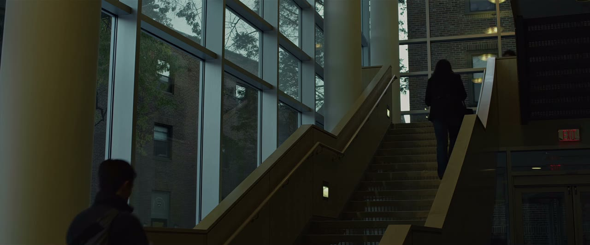

冷的窗光，暖的室内灯，人只是一个暗影。

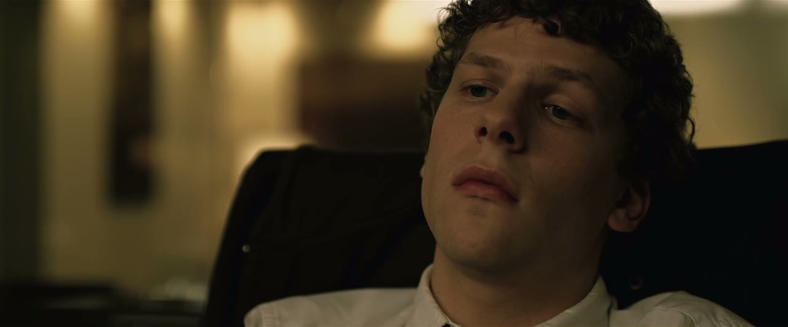

黄绿色的调子，脸有一半在暗处。

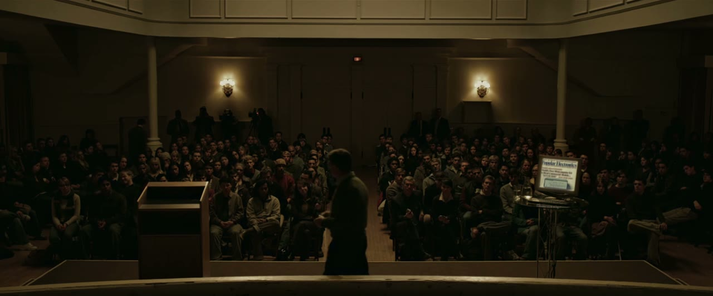

大场面也压得很暗，只留几盏灯。

《社交网络》(2010)，导演 大卫·芬奇，摄影 杰夫·克罗嫩韦思

<ul>
<li>镜头的运动和人物的运动完全同步。人站起来，镜头同时上升同样的幅度；人停，镜头停。因此你几乎感觉不到镜头在动，只觉得“稳”。</li>
<li>几乎不用手持。一旦出现手持，就说明有事不对了。</li>
<li>低饱和、偏黄绿的冷调，暗部很深。</li>
<li>对白剪得极密。《社交网络》的开场，两个人在酒吧五分钟说了别人十分钟的词。</li>
</ul>

<strong>可以借什么：</strong>“镜头只在主体动的时候动，并且动得一模一样”。虚拟运镜跟随一个移动的元素时，照这个要求做，稳定感会非常强。

<h3>丹尼斯·维伦纽瓦和罗杰·迪金斯：巨大，安静，单色</h3>

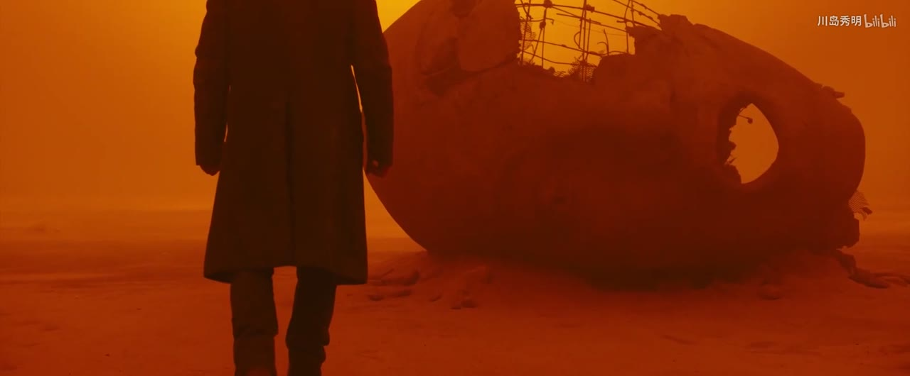

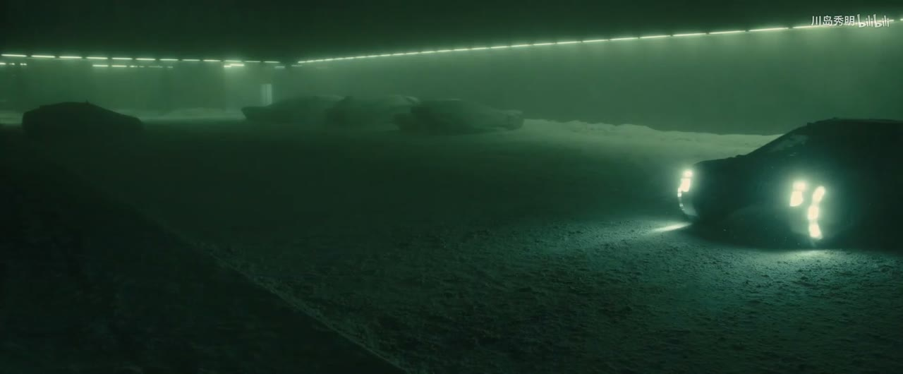

《银翼杀手 2049》(2017)，导演 丹尼斯·维伦纽瓦，摄影 罗杰·迪金斯

<ul>
<li>人很小，环境很大。大量的大远景，人只是画面里的一个剪影。</li>
<li>每个场景只有一个主色：橙、青、灰白、品红。</li>
<li>雾、沙尘、烟让光有了体积，也把背景简化成一片干净的色块。</li>
<li>节奏慢，镜头长，声音以低沉的氛围音为主。</li>
</ul>

<strong>可以借什么：</strong>一个场景一个颜色。做分章节的内容时，每一章换一个主色，观众不看标题也知道换章了。

<h2>内容频道</h2>

导演离日常太远的话，看看这些频道。它们各自发明或定型了一种今天被大量模仿的视频语言。

<table>
<tr><th>频道</th><th>它的规则</th><th>可以借什么</th></tr>
<tr><td>Vox</td><td>纸质拼贴的质感；地图、档案照片、图表被“摆”到桌面上；手绘的标注；记者偶尔出镜</td><td>用真实的档案材料讲故事；给素材一个统一的“纸”的容器</td></tr>
<tr><td>Kurzgesagt</td><td>扁平插画，深色底高饱和；每条片围绕一个大问题；结构严谨，有来源</td><td>用一套统一的插画语言处理任何题材；用可爱的画风讲沉重的话题</td></tr>
<tr><td>3Blue1Brown</td><td>黑底，用程序生成的数学动画；一切概念都被画成会动的几何图形；一个声音娓娓道来</td><td>“演出来”而不是“说出来”：让抽象的东西在屏幕上真的发生</td></tr>
<tr><td>Johnny Harris</td><td>地图和卫星图上的手绘标注；本人出镜；文件、截图大量推近；电影感的调色</td><td>地图推近加手绘圈注；用第一人称的调查过程做结构</td></tr>
<tr><td>Apple 的产品片</td><td>大量留白；产品是唯一的主角；镜头贴着产品表面缓慢移动；文字极少且极大</td><td>克制。一个画面只放一个东西</td></tr>
<tr><td>Casey Neistat</td><td>手持自拍；延时摄影过渡；跳切；音乐驱动；一天的时间线</td><td>Vlog 的全部语法都是他定型的</td></tr>
<tr><td>MrBeast</td><td>前五秒说清整条片的赌注；没有一秒空镜头；屏幕上永远有进度（倒计时、金额、人数）；每隔几十秒一个新的升级</td><td>留存的工程学：钩子、持续的进度感、不断加码</td></tr>
<tr><td>影视飓风</td><td>电影级的画面质量做科技和知识内容；段落之间用高质量的空镜和延时过渡</td><td>把实拍的质感当作内容的可信度</td></tr>
</table>
<h2>怎么“偷”才对</h2>

借鉴风格有一个陷阱：把一个导演的所有特征全搬过来。那样做出来的是拙劣的模仿，而且他的规则未必适合你的内容。更好的办法是只拿一两条。

<ol class="steps">
<li><b>拆</b>把你喜欢的那条片或那位作者，按六组旋钮各写一句：构图怎样，怎么动，怎么剪，什么颜色，什么声音，字怎么处理。</li>
<li><b>挑</b>问自己：让我觉得“好”的到底是哪一条？通常只有一两条是核心，其余是陪衬。</li>
<li><b>换</b>把那一两条规则用到你自己的内容和素材上，其他的旋钮按你自己的需要来定。</li>
<li><b>守</b>选定之后全片执行，不要中途换。风格来自坚持，不来自规则本身有多特别。</li>
</ol>
<blockquote>
<strong>别这么说</strong> 做成韦斯·安德森那种风格。

<strong>这么说</strong> 借韦斯·安德森的两条规则：严格的中心对称构图，和只走直线的镜头运动。其他不借：配色用我们自己的品牌色，不要糖果色；节奏按正常的讲解片来，不要他那种故意的停顿；字体用我们现有的。
</blockquote>

反过来也成立。当你看多了、拆多了，你会发现自己在某些旋钮上有固定的偏好：总是喜欢留白多的，总是受不了回弹，总是被暖色打动。把这些偏好写下来，就是你自己的规则。那份规则比任何一个大师的名字都更适合交给 AI。

<a href="styles.md">上一章 · 画风图鉴</a> · <a href="taste.md">下一章 · 什么叫好</a>

