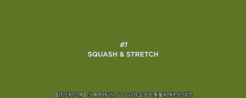
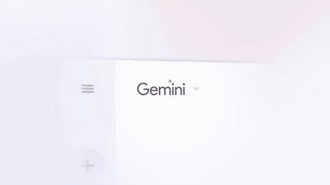
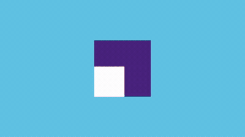

# 动效的底层规律

画面里的字、图、形状自己动起来，叫动效。它是 AI 用代码做片子时最拿手的部分，也是最容易做得“一股模板味”的部分。差别全在几条底层规律上。

<h2>动效在做什么</h2>

动态图形 <small>motion graphics</small>，行内简称 MG 或动效，指的是让图形、文字、图片这些设计元素随时间变化。它和“动画片”的区别是：动画片讲角色和故事，动效讲信息和关系。

一个元素的一生有三段，每段的动效任务不同：

<table>
<tr><th>阶段</th><th>任务</th><th>例子</th></tr>
<tr><td>进场 <small>in / enter</small></td><td>告诉观众“来了一个新东西，看这里”</td><td>标题滑入、卡片弹出、线条被画出来</td></tr>
<tr><td>停留 <small>hold</small></td><td>让观众看清、读完。大多数时候应该静止</td><td>偶尔做一次强调：闪一下、被圈出来、数字跳动</td></tr>
<tr><td>出场 <small>out / exit</small></td><td>让位给下一个东西，或者变成下一个东西</td><td>淡出、滑走、缩小、变形为新的元素</td></tr>
</table>

好的动效只做四件事：<strong>引导注意</strong>（动的东西先被看到）、<strong>解释关系</strong>（这个从那个里面出来，所以它们有关）、<strong>确认动作</strong>（按下去，它有反应）、<strong>赋予性格</strong>（同样是出现，稳稳地出现和蹦出来是两种品牌）。不属于这四件事的运动，都是噪音。

<h2>十二条原则，来自迪士尼</h2>

1981 年，迪士尼的两位元老动画师弗兰克·托马斯和奥利·约翰斯顿出了一本书叫《生命的幻象》，把公司几十年画角色的经验总结成十二条原则。它们本来是讲怎么让画出来的角色看起来活着，后来被整个动效行业拿去用了，因为让一个方块“有生命”的道理是一样的。

设计师 Cento Lodigiani 用一个小方块把十二条原则各演了一遍。这一段是前两条：挤压与拉伸、预备动作。一个没有脸的方块，因为落地时扁了一下、起跳前蹲了一下，就有了重量和意图。 <small>《The Illusion of Life》(2014)，Cento Lodigiani</small>

下面的演示把其中最常用的四条做成了“有它和没它”的对照。左边是直接移动，右边加了原则。

十二条全在这里。右边一列是它在图形动效里对应的做法，那才是你对 AI 说话时用得上的。

<table>
<tr><th>原则</th><th>原意</th><th>在动效里</th></tr>
<tr><td>挤压与拉伸 <small>squash &amp; stretch</small></td><td>物体受力变形，体积不变</td><td>元素落定时轻微压扁再恢复；快速移动时沿运动方向拉长</td></tr>
<tr><td>预备动作 <small>anticipation</small></td><td>大动作前有一个反方向的小动作</td><td>弹出前先缩一下；滑走前先往反方向退几像素</td></tr>
<tr><td>演出布局 <small>staging</small></td><td>让观众一眼看到该看的</td><td>同一时刻只有一个主要运动，其他都让路</td></tr>
<tr><td>逐帧画与关键姿势 <small>straight ahead / pose to pose</small></td><td>两种作画方法</td><td>对应“手绘逐帧”和“关键帧补间”两种做法</td></tr>
<tr><td>跟随与重叠 <small>follow through &amp; overlapping</small></td><td>主体停了，附属物还在动；各部分不同时到位</td><td>卡片先到，上面的字晚几帧到；停下时有一点余震</td></tr>
<tr><td>缓入缓出 <small>slow in &amp; slow out</small></td><td>起步和停下都要过渡</td><td>缓动曲线，下一节专门讲</td></tr>
<tr><td>弧线 <small>arcs</small></td><td>自然运动走曲线</td><td>元素沿弧线而非直线移动，尤其是有“抛”“甩”感的</td></tr>
<tr><td>次要动作 <small>secondary action</small></td><td>辅助主要动作的小动作</td><td>卡片落下时扬起几粒尘；数字到位时旁边闪一个小星</td></tr>
<tr><td>节奏 <small>timing</small></td><td>帧数决定重量和情绪</td><td>时长。大而重的东西慢，小而轻的东西快</td></tr>
<tr><td>夸张 <small>exaggeration</small></td><td>把动作推过头一点</td><td>回弹的幅度、变形的程度。越卡通越夸张</td></tr>
<tr><td>扎实的造型 <small>solid drawing</small></td><td>画出体积和重量</td><td>阴影、透视、层次保持一致</td></tr>
<tr><td>吸引力 <small>appeal</small></td><td>角色有魅力</td><td>整套动效有统一的、讨人喜欢的性格</td></tr>
</table>
<blockquote>
这十二条不是都要用，更不是用得越多越好。挤压拉伸和夸张用在卡通风格里很可爱，用在金融产品的介绍片里就轻浮了。真正到处都要用的只有三条：缓入缓出、演出布局、跟随与重叠。
</blockquote>
<h2>缓动：动效质感的头号因素</h2>

一个东西从 A 移到 B，速度怎么分配？这件事叫缓动 <small>easing</small>。它是区分“像模板”和“像专业”的第一道线。下面五个圆点走同样的距离、用同样的时间，只有速度的分配不同。

<table>
<tr><th>名字</th><th>速度怎么变</th><th>看起来</th><th>用在哪</th></tr>
<tr><td>匀速 <small>linear</small></td><td>始终一样快</td><td>机械、生硬。现实里几乎没有东西这么动</td><td>只用于持续不停的运动：慢推、旋转、进度条、滚动的背景</td></tr>
<tr><td>缓入 <small>ease-in</small></td><td>慢慢起步，越来越快</td><td>像被吸走、掉下去</td><td>出场。元素离开画面时加速离开</td></tr>
<tr><td>缓出 <small>ease-out</small></td><td>一上来很快，慢慢停下</td><td>像被扔进来、落到位。干脆又柔和</td><td>进场。最常用的一种</td></tr>
<tr><td>缓入缓出 <small>ease-in-out</small></td><td>慢—快—慢</td><td>从容、有分量</td><td>元素在画面内从一处移到另一处；镜头运动</td></tr>
<tr><td>回弹 <small>overshoot / back</small></td><td>冲过头一点再回来</td><td>有弹性、活泼</td><td>贴纸、图标、强调性的弹出。严肃风格慎用</td></tr>
<tr><td>弹簧 <small>spring</small></td><td>来回晃几下才停</td><td>更软、更有物理感</td><td>界面交互、卡通风格</td></tr>
</table>

记一条就够用：<strong>进来用缓出，出去用缓入，在画面里挪位置用缓入缓出。</strong>为什么进场用缓出？因为观众需要的是东西尽快出现在大致的位置，然后有时间看清它停稳；而出场时没人在意它的终点，走得越利索越好。

缓动还有“强度”。同样是缓出，可以很温和，也可以一开始极快然后拖一个很长的尾巴。后者行内叫 expo out 或 quint out，是现在产品片和高端广告里最流行的手感：利落地到位，然后几乎察觉不到地滑完最后几个像素。AI 写代码时用的词是 <code>cubic-bezier(0.16, 1, 0.3, 1)</code> 这样的四个数，你不用记，说“强缓出”“缓出的尾巴拖长一点”它就明白。

<blockquote>
<strong>别这么说</strong> 动画生硬，调自然一点。

<strong>这么说</strong> 缓动规则：所有进场用强缓出，前 30% 的时间走完 80% 的距离，尾巴拖长；出场用缓入，时长是进场的三分之二；元素在画面内换位置用缓入缓出。不要用匀速，除了背景的慢推和进度条。不要回弹。
</blockquote>
<h2>时长：多快算快</h2>

新手做的动效普遍太慢。一个标题花一秒半才飞到位，观众已经等烦了。下面是经验值。记住它们的量级，比记具体数字重要。

<table>
<tr><th>什么东西</th><th>进场时长</th><th>折合帧数（30 帧）</th></tr>
<tr><td>小元素：图标、标签、按钮反馈</td><td>0.15 到 0.25 秒</td><td>5 到 8 帧</td></tr>
<tr><td>中等元素：一行标题、一张卡片</td><td>0.3 到 0.5 秒</td><td>9 到 15 帧</td></tr>
<tr><td>大元素：整屏切换、大图、全屏背景</td><td>0.5 到 0.8 秒</td><td>15 到 24 帧</td></tr>
<tr><td>镜头运动、场景级的转换</td><td>0.6 到 1.2 秒</td><td>18 到 36 帧</td></tr>
<tr><td>抒情的、氛围性的漂移</td><td>2 秒以上</td><td>—</td></tr>
</table>
<ul>
<li><strong>越大越慢，越小越快。</strong>大东西移动得快会显得轻飘，小东西移动得慢会显得拖沓。</li>
<li><strong>出场比进场快。</strong>大约是进场的 60% 到 70%。</li>
<li><strong>距离越远，时间稍长，但不成正比。</strong>移动 100 像素用 0.3 秒，移动 1000 像素用 0.6 秒就够。</li>
<li><strong>总时长算清楚。</strong>一屏有 5 个元素依次进场，每个 0.4 秒、间隔 0.1 秒，全部到位要 0.8 秒。如果这一屏只停 2 秒，观众只剩 1.2 秒看内容。</li>
</ul>
<h2>进场方式的词汇表</h2>

元素“怎么出现”有十来种基本方式。每一种的性格不同。下面是同一行字的六种进场。

好镜头自己会说话

<table>
<tr><th>方式</th><th>英文</th><th>做法</th><th>性格</th></tr>
<tr><td>淡入</td><td><small>fade in</small></td><td>不透明度 0 到 100%</td><td>安静、不抢戏</td></tr>
<tr><td>滑入</td><td><small>slide in</small></td><td>从某个方向移动进来，通常同时淡入</td><td>有方向感，通用</td></tr>
<tr><td>缩放</td><td><small>scale in / pop</small></td><td>由小变大，可带回弹</td><td>活泼、强调</td></tr>
<tr><td>遮罩揭示</td><td><small>mask reveal / wipe on</small></td><td>元素本身不动，一条看不见的边扫过去把它露出来；或者元素从一条线后面升起来</td><td>干净、精致。高端片最爱</td></tr>
<tr><td>描边绘制</td><td><small>draw on / trim path</small></td><td>线条像被笔画出来一样从头长到尾</td><td>手工感、解说感。图表、箭头、圈注必备</td></tr>
<tr><td>打字机</td><td><small>typewriter</small></td><td>逐字出现</td><td>叙述、代码、悬念</td></tr>
<tr><td>逐字 / 逐词 / 逐行</td><td><small>per character / word / line</small></td><td>把文字拆开，每一份带延迟依次进</td><td>节奏感，跟着语音走</td></tr>
<tr><td>模糊聚焦</td><td><small>blur in</small></td><td>由虚到实</td><td>柔和、电影感</td></tr>
<tr><td>翻转</td><td><small>flip</small></td><td>绕轴转过来</td><td>卡片、揭晓、前后对比</td></tr>
<tr><td>形变</td><td><small>morph</small></td><td>一个形状平滑地变成另一个形状</td><td>聪明、连贯。表达“A 变成了 B”</td></tr>
<tr><td>计数</td><td><small>count up</small></td><td>数字从 0 滚到目标值</td><td>数据、成就</td></tr>
<tr><td>生长</td><td><small>grow</small></td><td>柱子长高、线延伸、圆扩大</td><td>图表的标准进场</td></tr>
</table>

选哪一种，取决于这个元素“是什么”。一条线应该被画出来，一个数字应该滚出来，一张照片应该被贴上来或者滑进来，一个标题适合遮罩揭示。让每种材质用符合它性质的方式出现，画面就不会有模板感。反过来，所有东西都用同一种“弹出”，就是模板感的来源。

<h2>错峰：不要一起到</h2>

一组元素进场时，让它们依次到达而不是同时到达，叫错峰 <small>stagger</small>。

间隔通常在 40 到 100 毫秒之间，也就是一到三帧。太短看不出先后，太长就成了一个一个报幕。错峰的顺序就是你希望观众阅读的顺序：从左到右，从上到下，或者从最重要的到最不重要的。

错峰还可以用在一个元素的内部：卡片的底板先到，上面的图晚两帧到，文字再晚两帧。这就是十二原则里的“重叠”。它让一个整体的进场有了层次，而总时长只多了一点点。

<h2>编排：一屏之内的先后</h2>

单个动效做对了，一屏里十个动效放在一起仍然可能很乱。把多个运动组织起来的工作叫编排 <small>choreography</small>。几条规矩：

<ul>
<li><strong>同一时刻只有一个主角在动。</strong>主要的运动进行时，其他元素要么静止，要么只做极小的配合。</li>
<li><strong>进场顺序等于阅读顺序。</strong>先出标题，再出图，再出说明。不要让说明比它说明的东西先出现。</li>
<li><strong>跟着声音走。</strong>有旁白的片子，元素在旁白说到它的那个词时出现，而不是在句子开头一股脑全出来。</li>
<li><strong>让运动有因果。</strong>一个元素的到达“推”出了下一个；一条线画到头，终点上才冒出一个标签。有因果的画面像一台机器在运转，没有因果的像一堆东西各飞各的。</li>
<li><strong>不要凭空出现和凭空消失。</strong>能从上一个状态变过来的，就不要淡入一个新的。上一屏的小图标放大成这一屏的主图，上一屏的数字移到角落变成这一屏的标签。这叫保持<strong>连续性</strong>，是高级动效最显眼的特征。</li>
<li><strong>清场要干脆。</strong>换屏时旧元素一起出，或者被新的画面整体推走，不要一个一个磨蹭着退。</li>
</ul>

动效工作室 Ordinary Folk 为 Google Gemini 做的发布片。注意几件事：文字是逐词出现的；界面卡片有前后层次，转动时带透视；从一屏到下一屏几乎没有“切”，总有一个元素延续过去；全片只有柔和的缓出，没有一处回弹。 <small>《Google Gemini》(2024)，Ordinary Folk</small>

动效公司 Buck 的标志演绎。几根彩色线条不断折叠、组合成不同的图形，最后拼出字母。每一步都从上一步变过来，没有任何东西是凭空出现的。 <small>Buck 标志动画</small>

<h2>强调和持续</h2>
<h3>强调动效</h3>

元素已经在画面上了，你想让观众再看它一眼。常用的手法：

<table>
<tr><th>手法</th><th>做法</th></tr>
<tr><td>脉冲 <small>pulse</small></td><td>放大到 105% 再回来，一次</td></tr>
<tr><td>圈注与划线</td><td>手绘感的圈、下划线、箭头被画出来</td></tr>
<tr><td>高亮扫过 <small>highlight sweep</small></td><td>一道荧光笔色块从左到右划过文字底部</td></tr>
<tr><td>变色</td><td>关键词从字色变成强调色</td></tr>
<tr><td>其余变暗</td><td>不动重点，把其他元素压暗、变糊</td></tr>
<tr><td>抖动 <small>shake / wiggle</small></td><td>左右快速晃两三下。表示错误、警告、搞笑</td></tr>
</table>
<h3>持续动效</h3>

元素停留期间一直在进行的小运动：轻微的上下漂浮、缓慢的旋转、呼吸般的缩放、背景粒子的流动。它能让画面“活着”，但也是最容易过量的。一屏里所有东西都在漂，观众会晕，也读不进字。原则是：背景可以有极缓慢的持续运动，前景要读的东西保持静止。

<h2>两个增加质感的细节</h2>

运动模糊 <small>motion blur</small>：快速移动的东西在每一帧上留下拖影。真实摄影机拍运动物体都会有。给动效加上运动模糊，快速的移动会显得顺滑而有速度感；不加，则是干净利落的“数码感”。两种都对，全片统一就行。

<strong>帧率质感</strong>：动效不一定要每一帧都更新。手绘动画传统上每秒只画 12 张，每张停两帧，行内叫一拍二 <small>on twos</small>。这种略带顿挫的运动有手工的温度，《蜘蛛侠：平行宇宙》把它用成了标志。如果你要“手绘感”“定格感”，可以要求元素的运动降到每秒 12 帧甚至 8 帧，而镜头和文字仍然保持流畅。

<h2>动效的性格</h2>

把上面的旋钮组合起来，就得到一套动效的“性格”。它应该和品牌、内容的气质一致。四种常见的性格和它们的参数：

<table>
<tr><th>性格</th><th>缓动</th><th>时长</th><th>典型动作</th><th>适合</th></tr>
<tr><td>稳重</td><td>强缓出，无回弹</td><td>中等偏长</td><td>遮罩揭示、淡入、慢推</td><td>金融、科技、企业、纪录</td></tr>
<tr><td>利落</td><td>很强的缓出，接近瞬间到位</td><td>短</td><td>硬切、快速滑入、闪现</td><td>新闻、潮流、快节奏解说</td></tr>
<tr><td>活泼</td><td>回弹、弹簧</td><td>短到中等</td><td>弹出、挤压拉伸、抖动</td><td>儿童、消费品、搞笑、生活方式</td></tr>
<tr><td>柔和</td><td>缓入缓出，曲线平缓</td><td>长</td><td>模糊聚焦、漂浮、缓慢形变</td><td>健康、美妆、情感、艺术</td></tr>
</table>
<h2>给 AI 一份动效规格</h2>

和颜色、字体一样，动效也应该在开工时定好一套规则，全片照此执行。行内叫 motion spec。它不长，但能避免“每个元素一种动法”。

<strong>动效规格 · 示例（稳重、纸质风格）</strong>
<pre><code>性格　　稳、短、不回弹。像把纸片放到桌上。
缓动　　进场强缓出；出场缓入；位移缓入缓出。除背景慢推外不用匀速。
时长　　小元素 0.2s，卡片与标题 0.4s，整屏切换 0.6s。出场为进场的 2/3。
进场　　文字：从下方 24px 滑入并淡入。
　　　　截图与卡片：从略大（104%）落到 100%，带极轻的投影变化，像贴上去。
　　　　线条、圈、箭头：描边绘制，0.5s。
　　　　数字：滚动计数，0.8s，先快后慢。
错峰　　同屏多个元素间隔 60ms，按阅读顺序。
停留　　进场完成后静止。背景允许 4 秒 3% 的慢推。
强调　　只用手绘橙色圈和下划线，每屏最多一处。
出场　　整屏元素一起向上滑出并淡出，0.25s；或被下一屏推走。
连续　　能延续到下一屏的元素不重新进场，移动到新位置即可。
质感　　不加运动模糊；手绘线条按每秒 12 帧更新，其余 30 帧。</code></pre>
<blockquote>
<strong>这么说</strong> 按上面这份动效规格做全片。做完后自查：有没有哪个元素的进场方式不在规格里；有没有哪一屏同时超过一个主要运动；有没有进场完成后还在持续运动的前景元素。把不符合的列出来并修正。
</blockquote>

<a href="sound.md">上一章 · 声音</a> · <a href="type.md">下一章 · 文字、图形与片头</a>

