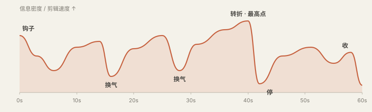

# 排片

前面讲的都是一个镜头、一刀、一个动效怎么做。这一章讲顺序：先放什么后放什么，一段话配什么样的画面，一条片子怎么开头和收尾。

<h2>注意力是一条往下掉的线</h2>

所有平台的后台都有一张图叫留存曲线：横轴是时间，纵轴是还在看的人的比例。它永远是从左上往右下掉的，区别只在掉得多快。短视频通常在前三秒掉得最狠，之后每一个让人觉得“没新东西了”的瞬间，线就往下跳一格。

排片这件事，说到底是在和这条线打交道。你有三个工具：开头用<strong>钩子</strong>把线顶住；中间靠<strong>不断给出新东西</strong>让它平着走；在它快要掉的地方安排<strong>转折或换气</strong>。

“新东西”不一定是新信息。画面换了一种形式、音乐变了、节奏变了、出现了一个问题，都算。一条片子从头到尾是同一个景别的人脸加字幕，哪怕内容很好，也会因为“看起来没在变”而被划走。

<h2>钩子：前三秒做什么</h2>

钩子 <small>hook</small>是片子开头用来留住人的那一小段。它不是标题，不是自我介绍，也不是“大家好”。它要在一两句话、两三个镜头之内，让观众产生一个非看下去不可的理由。常用的有七种：

<table>
<tr><th>钩子</th><th>做法</th><th>例子</th></tr>
<tr><td>结果前置</td><td>把全片最精彩的画面或最终成果放到第一秒，然后倒回去讲</td><td>先放改造完的房间 2 秒，再“三个月前它是这样的”</td></tr>
<tr><td>反常识</td><td>一句和直觉相反的断言</td><td>“多修一条路，这个城市反而更堵了。”</td></tr>
<tr><td>提问</td><td>问一个观众答不上来但想知道的问题</td><td>“为什么电影都是 24 帧，而不是 25 或者 30？”</td></tr>
<tr><td>冲突</td><td>直接从矛盾最尖锐的时刻开始</td><td>“甲方看完第一版，只回了两个字。”</td></tr>
<tr><td>数字</td><td>一个具体到让人意外的数</td><td>“这条 60 秒的片子，剪了 47 刀。”</td></tr>
<tr><td>视觉奇观</td><td>一个没见过的画面，不需要解释</td><td>微距、延时、航拍、一个巧妙的转场</td></tr>
<tr><td>点名</td><td>直接说出目标观众的处境</td><td>“如果你每次让 AI 改片都只会说‘再调调’……”</td></tr>
</table>

钩子的画面也要配得上。说“反常识”那句话的时候，屏幕上应该是大字、特写或者一个强画面，而不是一个慢慢淡入的标题动画。前三秒里每一帧都很贵。

<blockquote>
<strong>别这么说</strong> 开头吸引人一点。

<strong>这么说</strong> 开头用“结果前置”：第一个镜头直接放成品效果最好的 2 秒，硬切进，不要任何片头和 logo。紧接着黑底大字“它是用一句话做出来的”，停 1.2 秒。第 4 秒才开始正文。前三秒音乐就要是满的，不要从渐入开始。
</blockquote>
<h2>几种现成的骨架</h2>

结构不需要发明。下面几种骨架覆盖了九成的片子，选一个往里填就行。告诉 AI 你用哪一种，它就知道段落怎么分。

<table>
<tr><th>骨架</th><th>顺序</th><th>适合</th></tr>
<tr><td>问题—答案</td><td>抛问题 → 常见的错误理解 → 真正的答案 → 一个例子 → 一句话收</td><td>知识讲解、科普</td></tr>
<tr><td>清单</td><td>钩子 → 第 1 条 → 第 2 条 → … → 最重要的一条放最后</td><td>“五个技巧”“三个误区”这类</td></tr>
<tr><td>对比</td><td>A 是这样 → B 是这样 → 为什么不同 → 你该选哪个</td><td>测评、方案比较、前后改造</td></tr>
<tr><td>步骤</td><td>成品预览 → 第一步 → 第二步 → … → 成品回放</td><td>教程、操作演示</td></tr>
<tr><td>痛点—方案</td><td>痛点（让人点头）→ 放大后果 → 方案出现 → 证明有效 → 行动</td><td>产品介绍、广告</td></tr>
<tr><td>故事</td><td>人物想要什么 → 遇到阻碍 → 尝试与失败 → 转机 → 结果与变化</td><td>个人经历、案例、品牌片</td></tr>
<tr><td>时间线</td><td>按时间先后一路讲下来，可以在开头预告结局</td><td>Vlog、复盘、历史梳理</td></tr>
</table>

不管用哪种，有三个位置是固定要设计的：<strong>开头</strong>的钩子；中间偏后的一个<strong>转折</strong>，就是“但是”“没想到”“真正的原因是”出现的地方，全片的最高点通常在这；以及<strong>结尾</strong>。

<h3>结尾怎么收</h3>

结尾最常见的错误是没有结尾：话说完了，画面一黑。或者相反，放一长段“感谢观看、点赞关注”的片尾。几种稳妥的收法：

<ul>
<li><strong>回扣开头。</strong>回到开头的那个问题或画面，这次带着答案。最容易给人“完整”的感觉。</li>
<li><strong>一句话结论。</strong>全屏只留一行字，停一秒半，音乐同时落下最后一个音。</li>
<li><strong>留一个动作。</strong>告诉观众现在可以做的一件具体小事。</li>
<li><strong>戛然而止。</strong>在最高点直接结束。只有前面铺垫足够才成立，但成立的时候很有劲。</li>
</ul>
<h2>段落和换气</h2>

把全片分成若干小节，每节 10 到 25 秒，只讲一件事。节与节之间要让观众感觉到“换了一段”：可以是画面形式变了，可以是音乐变了，可以是一个半秒的停顿，也可以是一张只有小标题的过渡卡。

在一节内部，信息密度也不该是平的。一个好用的模型是“讲—证—停”：先用一句话讲出这一节的观点，然后给证据（截图、数据、演示），最后留一个短暂的空当让它沉下去。这个空当行内叫换气 <small>beat</small>或“一拍”，往往只有半秒到一秒，可以是一个空镜、一个表情，或者干脆是画面停住不动。

没有换气的片子就是你说的“太赶”“太满”。很多人以为快节奏等于不留空，结果观众一句都没记住。真正节奏快的片子，是在密集之后停得很准。

一条 60 秒讲解片的密度曲线示意。高的地方是信息密集、镜头短的段落，低谷是换气。注意它整体朝着第 40 秒左右的转折点爬升，那之后再没有比它更高的地方。

<h2>什么内容，用什么形式</h2>

这是排片里最具体、也最有用的一部分。旁白里的每一句话，都属于某种“类型”：它是一个数字，还是一个对比，还是一个过程？每种类型都有几种被验证过的画面形式。新手的片子之所以像 PPT，是因为不管什么内容都用同一种形式：一行标题加几个要点。

下面这张表可以当菜单用。拿到文案后，一句一句地问“这句话是什么类型”，然后从右边挑。

<table>
<tr><th>这句话在说</th><th>可以用的画面形式</th><th>要点</th></tr>
<tr><td>一个数字</td><td>全屏大数字，滚动计数到位；或柱状图里只有这一根是亮的</td><td>数字要是全屏最大的东西，单位小一号。旁白念到它的时候它正好到位</td></tr>
<tr><td>两个东西的对比</td><td>左右分屏；同一位置前后切换；一条滑杆左右拉</td><td>两边的构图、大小、位置必须一致，只让“不同的那一点”不同</td></tr>
<tr><td>一个过程或步骤</td><td>步骤条逐格点亮；流程图沿着箭头依次出现；录屏加光标高亮</td><td>一次只亮一步，已完成的变灰，未到的不出现</td></tr>
<tr><td>若干并列的条目</td><td>清单逐条贴上；卡片依次排开；网格逐格填入</td><td>条目超过五个就分屏。每条出现时配同一个音效</td></tr>
<tr><td>一句引用或别人的话</td><td>引文卡加出处；原始截图（推文、论文、新闻）加高亮划线</td><td>尽量用原始截图，比重新打一遍字可信得多</td></tr>
<tr><td>“这是真的”</td><td>实拍、录屏、新闻原图、数据来源页</td><td>真实素材带着它自己的“粗糙”，这种粗糙就是可信度，不要美化掉</td></tr>
<tr><td>一个地点</td><td>地图从大范围推近到那个点；卫星图；街景</td><td>先给观众认识的大范围，再推进去</td></tr>
<tr><td>随时间的变化</td><td>折线从左画到右；时间轴上的节点依次亮起；同一画面的延时</td><td>线要“画”出来，而不是整条淡入</td></tr>
<tr><td>一个东西的构成</td><td>拆解图：整体散开成零件，各自标注；剖面</td><td>先给完整的样子，再拆</td></tr>
<tr><td>因果关系</td><td>一个元素的动作触发另一个元素的变化：推倒、点亮、连线</td><td>因和果要出现在同一屏里，并且真的“碰到”</td></tr>
<tr><td>一个抽象概念</td><td>找一个日常的东西做比喻，把比喻画出来</td><td>画那个东西本身，不要用圆圈和箭头代替</td></tr>
<tr><td>一个产品功能</td><td>真实界面的录屏，推近到操作的位置，光标或手指做出动作</td><td>去掉无关的界面，只留这个功能所在的那一块</td></tr>
<tr><td>情绪、态度、观点</td><td>人脸的近景或特写；一个有氛围的空镜配音乐</td><td>这时候不要盖 B-roll，让人看到说话的人</td></tr>
<tr><td>全片最重要的一句话</td><td>全屏只有这一句，其他都清空；前面停半拍</td><td>全片只用一次</td></tr>
<tr><td>过渡、承上启下</td><td>空镜；小标题卡；画面内容不变但镜头缓慢移动</td><td>一秒左右就够，它的任务是让人喘口气</td></tr>
</table>
<blockquote>
这张表的核心原则是：<strong>旁白说到什么，屏幕上就是什么；旁白里的动词，画面上真的发生。</strong>旁白说“下降了”，那条线就要往下走；说“被替代了”，旧的那个就要被新的盖住或挤走。画面如果只是“相关”，而不是“演出来”，观众就得一边听一边自己脑补，很快就累了。
</blockquote>
<h3>一个例子</h3>

拿一小段文案来走一遍。原文：

<blockquote>去年这个团队只有三个人，做一条视频要两周。今年他们还是三个人，但一周能出五条。多出来的不是人手，是他们把剪辑交给了 AI，自己只负责说清楚要什么。</blockquote>
<table>
<tr><th>句子</th><th>类型</th><th>画面</th><th>时长</th></tr>
<tr><td>去年这个团队只有三个人，做一条视频要两周。</td><td>数字 + 时间</td><td>左侧三个人形图标；右侧一格日历，14 天逐格划掉，最后落出一个视频图标</td><td>4 秒</td></tr>
<tr><td>今年他们还是三个人，但一周能出五条。</td><td>对比</td><td>画面结构不变（这样才看得出是对比）。日历只划掉 7 天，落出五个视频图标，一个接一个弹出</td><td>3.5 秒</td></tr>
<tr><td>多出来的不是人手，</td><td>否定</td><td>镜头推近到三个人形图标，一个加号出现在旁边，然后被划掉</td><td>1.5 秒</td></tr>
<tr><td>是他们把剪辑交给了 AI，</td><td>因果</td><td>一把剪刀图标从人的手里滑到一个对话框里</td><td>2 秒</td></tr>
<tr><td>自己只负责说清楚要什么。</td><td>最重要的一句</td><td>清空画面。全屏大字“说清楚要什么”，停住</td><td>2.5 秒</td></tr>
</table>

五句话，五种不同的画面形式，而且前两句故意用了同一个版式来做对比。这就是“排”的意思。

<h2>时间的账</h2>

排片时最容易翻车的地方是时间算不过来：画面设计得很好，但旁白一句话三秒就念完了，画面里的东西根本来不及出完。下面几个数字帮你提前算账。

<table>
<tr><th>项目</th><th>经验值</th></tr>
<tr><td>中文口播语速</td><td>正常每秒 4 到 5 个字，快节奏短视频每秒 5 到 6 个字。一分钟大约 250 到 330 字</td></tr>
<tr><td>屏幕文字的阅读速度</td><td>观众每秒能读 6 到 8 个字。一行 12 个字至少停 2 秒，而且要算上它进场的时间</td></tr>
<tr><td>一个画面被“看懂”</td><td>简单画面（一个主体）约 0.5 秒；带文字的信息画面 2 到 4 秒；复杂图表 5 秒以上，并且要有引导</td></tr>
<tr><td>一句旁白配几个画面</td><td>通常一句一个。长句可以拆成两三个，但每个不短于 1 秒</td></tr>
<tr><td>字幕</td><td>每行不超过 14 到 16 个字，最多两行。按语气断句，不要把一个词拆到两行</td></tr>
</table>

反过来也能用这些数字倒推文案：要做一条 60 秒的片子，文案就写 260 到 300 字，再多一定讲不完，除非你接受机关枪一样的语速。

<h2>导演表：把排片写下来</h2>

排片的结果是一张表，行内叫分镜表、镜头表，或者导演表。它是你和 AI 之间最重要的一份文件：在动手做任何画面之前，先把这张表对齐。

<strong>导演表 · 模板</strong>
<pre><code>#　时间　　　旁白　　　　　　　　　　类型　　画面　　　　　　　　　　　　　运动与衔接　　　　　　声音　　　　　　作用
1　0:00–0:02　多修一条路，城市反而更堵了　反常识　航拍堵车画面，上面压大字　　硬切进；字 0.3s 弹出　　鼓点直接进　　　钩子
2　0:02–0:05　这不是段子，是数学　　　　　断言　　字清空，留一行公式手写出现　　笔迹 0.8s 写完　　　　铅笔声　　　　　建立可信
3　0:05–0:11　1968 年，德国数学家……　　　引用　　论文首页截图，推近到标题　　推近 0.6s 缓出　　　　翻纸声　　　　　给出处
…</code></pre>
<blockquote>
<strong>这么说</strong> 根据下面的文案出一张导演表。先把每句话标出类型（数字、对比、过程、列举、引用、实证、因果、概念、观点、过渡），再从对应的画面形式里选。要求：相邻两镜尽量不用同一种形式；全片找出最重要的一句，给它单独一屏；每 15 秒左右安排一处换气；算一下每镜的时长，保证屏幕上的字读得完。表格列：序号、时间、旁白、类型、画面、运动与衔接、声音、作用。
</blockquote>

拿到表之后你要审的是：钩子够不够硬；每一镜的画面是在“演”旁白，还是只是“配”旁白；有没有连着好几镜长得一样；最高点在哪、前面有没有给它让路；总时长对不对。这五条都过了，再让它动手。

<a href="taste.md">上一章 · 什么叫好</a> · <a href="recipes.md">下一章 · 一键动效 Prompt</a>

